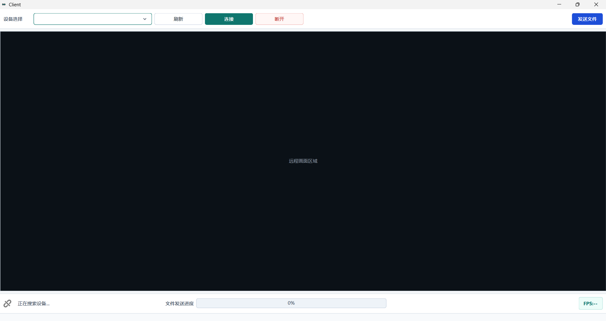
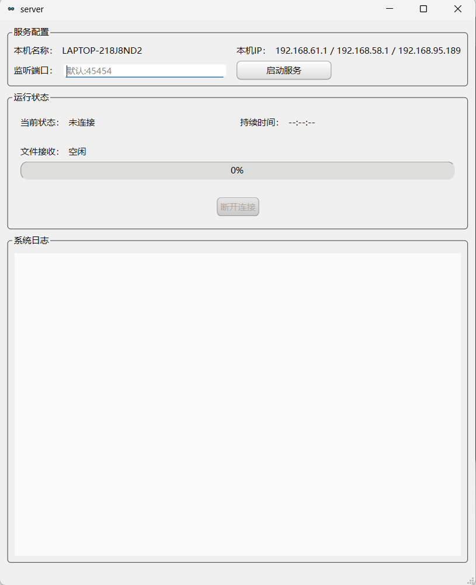

# RemoteLink

RemoteLink 是一个基于 Qt/C++ 的局域网远程控制项目，包含 server 和 client 两端程序。

server 运行在被控制端，负责屏幕采集、远程输入执行、文件接收和局域网发现响应；client 运行在控制端，负责搜索设备、建立连接、显示远程画面、发送鼠标键盘事件和传输文件。

## 主要功能

- 局域网自动发现 server 设备
- TCP 连接远程主机
- server 端基于 DXGI 采集屏幕，JPEG 视频通过 UDP 分片发送
- client 端远程画面显示
- 鼠标移动、点击、滚轮控制
- 键盘事件转发
- client 向 server 发送文件，FileData payload 已拆成分片头 + chunk
- 基于 socket 写缓冲的简单背压控制
- client 解码线程只保留最新帧，降低画面延迟堆积
- TCP 控制/文件通道与 UDP 视频通道分离

## 核心技术与实现

- 基于 Qt 6 Widgets 构建 client/server 双端界面
- 使用 Qt Network 实现 TCP 长连接与 UDP 局域网发现
- 自定义二进制 TCP 包格式，包含 `sessionId` 和最大 payload 长度保护
- server 端采用独立网络线程和独立截图线程，降低 UI 阻塞
- client 端采用独立 JPEG 解码线程，并实现只保留最新帧的低延迟策略
- 基于 DXGI Desktop Duplication 进行 Windows 桌面采集
- 使用 Windows API 执行远程鼠标和键盘输入
- 文件传输支持分块读取和 socket 写缓冲水位控制
- 使用 QSS 对 client/server 界面进行统一样式定制

## 界面预览

### Client



### Server



## 项目结构

```text
RemoteLink
├── client      # 控制端程序
├── server      # 被控制端程序
├── common      # 公共协议模块
├── resources   # QSS 和图标资源
└── docs        # 架构、协议和演示文档
```

## 基本使用

1. 在被控制电脑上启动 server。
2. 在 server 界面点击“启动服务”。
3. 在控制电脑上启动 client。
4. client 搜索到 server 后，选择设备并点击连接。
5. 连接成功后即可查看远程画面，并进行鼠标键盘控制。
6. 如需传输文件，在 client 端选择文件发送，server 会保存到程序目录下的 `downloads` 文件夹。

默认端口：

| 用途 | 端口 |
| --- | ---: |
| TCP 远程连接 | 45454 |
| UDP 设备发现 | 45455 |
| UDP 视频传输 | 45456 |

## 文档

- [系统整体架构设计文档](docs/system_design.md)
- [自定义 TCP/UDP 通信协议说明](docs/protocol.md)
- [简短演示文档](docs/demo.md)

## 当前状态

这是一个学习和实践性质的远程控制项目，核心链路已经包括设备发现、画面传输、远程输入和文件传输。当前实现主要面向 Windows 局域网环境，协议层已经收口到 `sessionId`、最大 payload 限制，以及视频/文件二级 payload 头。尚未加入加密认证、多客户端管理、断点续传和屏幕增量传输等能力。

## 重构进度

| 阶段 | 状态 | 当前结果 |
| --- | --- | --- |
| 1. 收口协议 | 已完成定义层和编解码层 | TCP 包头含 `sessionId`，限制最大 payload，消息类型已移除旧 TCP 视频项；文件与视频 payload 有各自头部。统一错误码目前仅定义，尚未贯穿业务错误处理。 |
| 2. 拆分通道 | 已完成 | TCP 承载心跳、输入控制和文件；UDP 承载设备发现与视频。 |
| 3. UDP 视频 | 已完成基础链路 | 保留 JPEG，支持 UDP 分片、校验、重组、丢弃未完成旧帧和只保留最新帧；当前没有 ACK/重传。 |
| 4. 工程化 | 进行中 | 已有连接重连、采集/编码/收发/解码/显示及文件吞吐日志；配对码/认证尚未实现，UDP 丢包率也没有端到端确认统计。 |
| 5. 编码升级 | 未开始 | 暂无 FFmpeg H.264/H.265。 |
| 6. 界面补齐 | 未开始 | 继续使用现有 Widgets，尚未增加独立性能面板和日志面板。 |

当前总体完成到第 3 阶段；第 4 阶段已有基础设施，但还未完成认证和可靠的端到端网络统计。详细模块说明见 [系统设计](docs/system_design.md)，测量口径见 [性能测试记录](docs/performance_test.md)。
